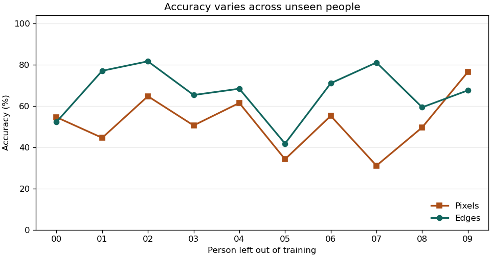
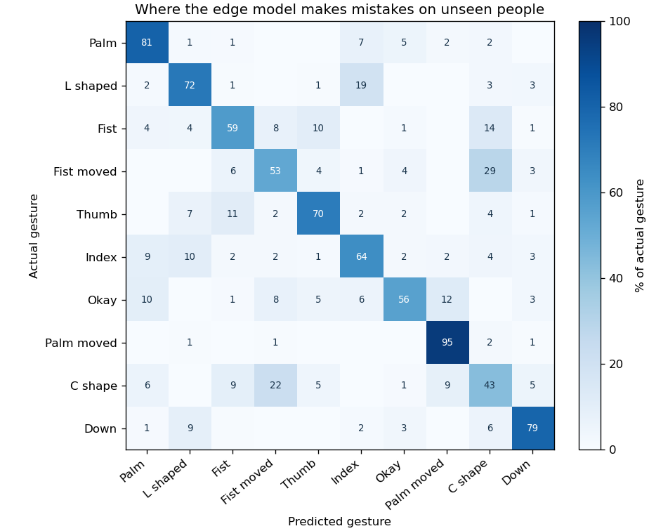

# Can an infrared gesture model recognize a new person?

A camera-based controller has to recognize a hand gesture from someone it has never seen. Testing on randomly selected frames can make that job look easier, because training and test sets can contain nearby frames of the same person's gesture. This capstone measures how much the test split changes the result on **LeapGestRecog**, a dataset of 20,000 near-infrared hand-gesture frames from ten people.

## Results

| Input features | Random-frame accuracy | Unseen-person accuracy | Random-frame macro F1 | Unseen-person macro F1 |
| --- | ---: | ---: | ---: | ---: |
| Grayscale pixels | 99.6% | 52.3% | 0.996 | 0.521 |
| Edge directions | 99.5% | 66.8% | 0.995 | 0.668 |

The edge model scored **32.7 percentage points lower** when tested on unseen people. It still improved on the pixel model by **14.5 points** under that split, using 225 features instead of 1,600. Its accuracy ranged from 41.8% to 81.7% across people. The confusion matrix shows a recurring mistake: the model predicted C shape for 29% of the Fist moved frames.

The audit retained **19,466 of 20,000 frames**. It removed 246 repeated copies with matching labels and 288 frames from groups with conflicting person or gesture labels. For example, `frame_02_08_0057.png` and `frame_05_08_0001.png` had identical grayscale pixels despite carrying different person IDs.





## How the study works

1. Check the grayscale pixels for exact duplicates. Keep one copy when the person and gesture agree. Drop every copy when the same image appears under different people or gestures.
2. Crop around the bright hand and fit it into a 40 × 40 grayscale image. Compare the 1,600 pixel values with 225 features that summarize edge directions across small patches.
3. Train the same linear SVM classifier on both representations. First, use a stratified random 90/10 split. Then run ten more splits, each time training on nine people and testing on the tenth. Each retained frame gets one prediction from a model that never trained on that person.
4. Report accuracy and macro F1, which gives each gesture equal weight. The combined unseen-person score uses the held-out predictions pooled across all ten people.

These scores apply to single frames of the ten labeled gestures, captured in a controlled infrared setup. A webcam or live control system would need a separate evaluation. Nearby frames can still be highly similar after removing exact duplicates.

## Run the study

Use Python 3.10–3.12. Download the [Hand Gesture Recognition Database from GTI on Kaggle](https://www.kaggle.com/datasets/gti-upm/leapgestrecog) and extract it. Use the folder directly containing the person folders `00` through `09`. The class-organized version with folders such as `Palm` and filenames such as `frame_00_01_0001.png` also works.

```bash
python -m pip install -r requirements.txt
python study.py --data "path/to/leapGestRecog"
```

If the data folder is `data/leapGestRecog` inside the repository, run `python study.py` on its own. From the local capstone folder next to `gestureRecognition`, use `python study.py --data ../gestureRecognition`. The study saves the metrics, figures, and an edge model trained on all retained frames in `outputs/`.

To try the fitted classifier on a dataset frame, replace the path below with an actual image path.

```bash
python predict.py "path/to/frame_00_01_0001.png"
```

## Files

| File | What it contains |
| --- | --- |
| [features.py](features.py) | Hand cropping and edge features |
| [study.py](study.py) | Data checks, training, evaluation, and plots |
| [predict.py](predict.py) | Single-image prediction |
| [results/](results/) | Saved audit, metrics, and figures from the full run |

The archived results are from the local class-organized copy. The original images are available from the dataset provider at the link above.
